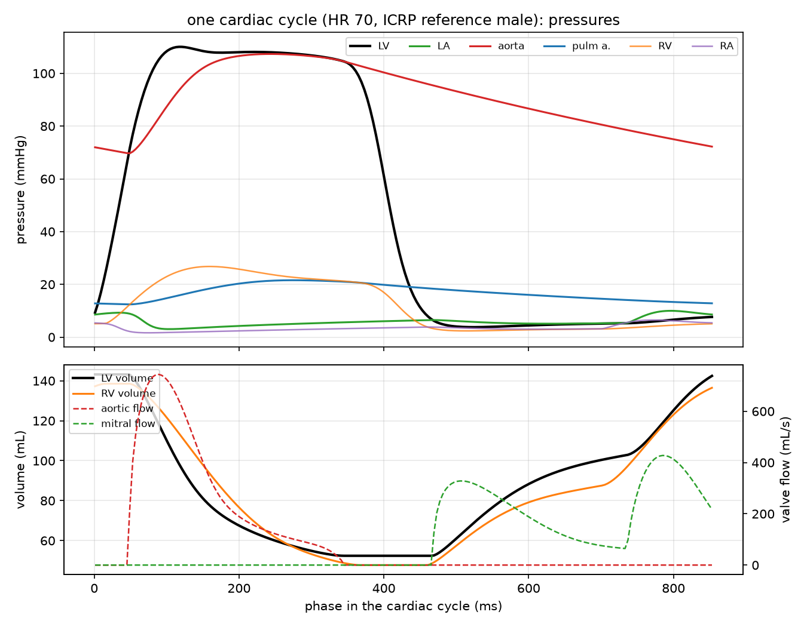
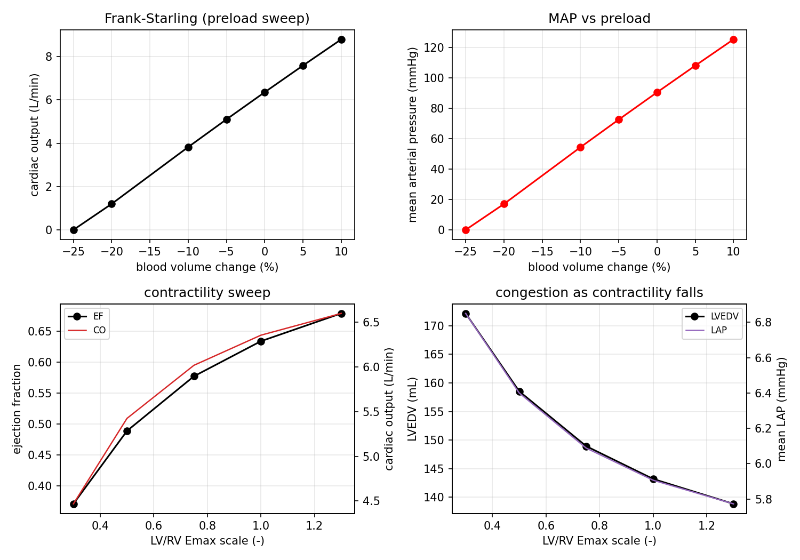
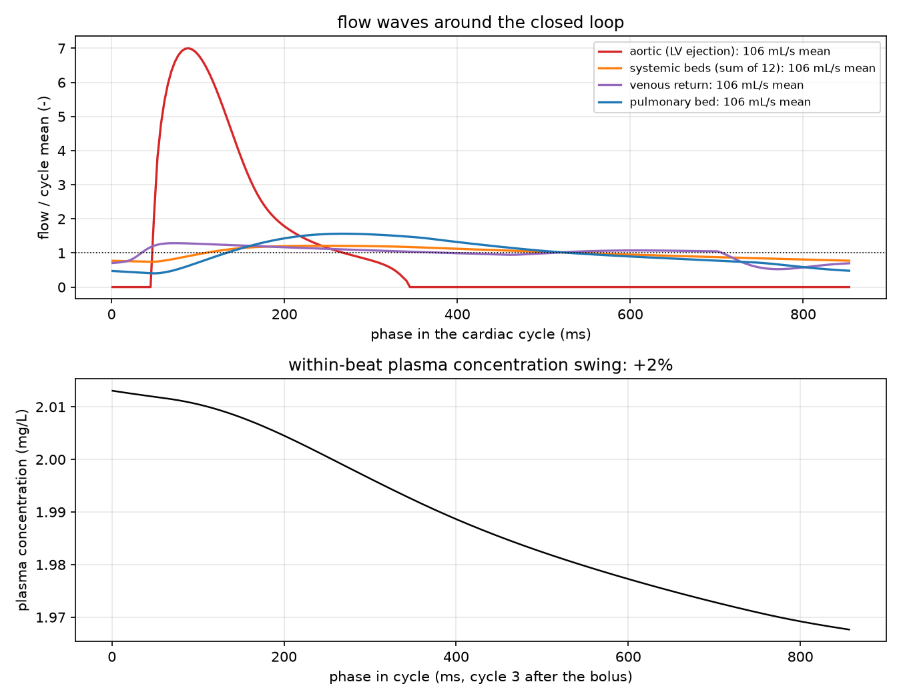
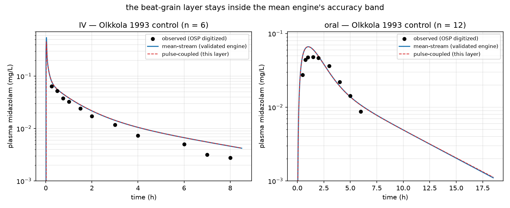
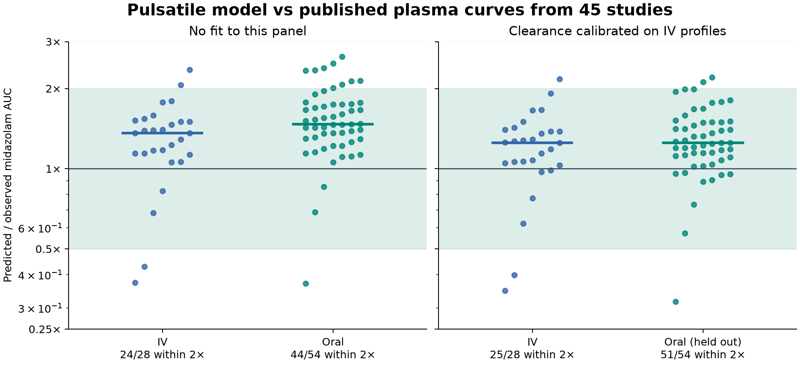

# The beating heart, the closed circulation, and the drug riding it

`vh.graph.circulation` turns the conserved-flow machinery of
[`bernoulli_veins.md`](bernoulli_veins.md) into a **beating heart driving the
whole circulation**; `vh.graph.uptake` puts the drug mass balance of the
validated PBPK engine on the flows that heart actually produces. This page
explains the model and its limits; the measured numbers and their independent
authorities are in [`validation_circulation.md`](validation_circulation.md).

Reproduce:

```bash
python scripts/validate_circulation.py
pytest -q tests/test_circulation.py
```

## Structure

```
  atria ──valves──▶ ventricles ──valves──▶ arteries ──▶ 12 ICRP organ beds ──▶ veins ──▶ atria
     ▲                                                                                    │
     └──────────────────────── pulmonary: RV ─▶ lungs ─▶ LA ◀──────────────────────────────┘
```

One closed loop, eight storage nodes, four one-way valves, twelve organ beds.
Everything is a typed graph (`build_circulation_graph`) with a schema that makes
the structural claims checkable: every storage node has an inflow and an
outflow, the bed shares sum to 100 %, every resistance and valve area is
positive.

<p align="center">
  
</p>

## The equations

Units: pressure mmHg, volume mL, flow mL/s, time s.

| Element | Law | Source of the parameters |
|---|---|---|
| chamber `i` | `p_i = E_i(t) (V_i − V0_i)`, `E_i` a double-Hill time-varying elastance | Suga & Sagawa 1974; Stergiopulos et al. 1992/1996; Emax/Emin/V0 from the published normal table |
| valve `e` | `q_e = A_eff √(2 max(p_src − p_dst,0) · 133.32 / ρ)`, exactly zero reversed | published normal valve areas (4–6, 3–4 cm²), Cd 0.90 |
| pool `j` | `p_j = (V_j − V0_j) / C_j` | compliance and blood-volume distribution of the published normal table |
| bed `t` | `q_t = (p_sa − p_sv) / R_t`, with `R_t = (MAP_ref − RAP_ref) / (share_t · CO_ref)` | ICRP 89 organ flow shares |
| venous return | `q = max(p_sv − p_ra, 0) / R` (Starling waterfall) | published caval pressure drop at rest |
| pulmonary bed | `q = (p_pa − p_pv) / R` (bidirectional) | published normal pulmonary vascular resistance |

The node balance is `dV/dt = Σ q_in − Σ q_out`, integrated with RK4. `Σ V` is a
linear invariant of the right-hand side, so total blood volume is conserved to
machine precision however the valves open and close — and because the two
ventricles sit in one loop, their stroke volumes must agree. Both are checked in
the tests: they are identities of the equations, not fitted behaviour.

## What is predicted, and against what

No parameter is fitted to an output. Each component is anchored to a published
source (valve areas, compliances, Emax/Emin, blood-volume split, ICRP shares),
and the **joint output** is compared with the published normal-physiology column
of Broomé et al. 2013 (Table 1), a different model's normal values:

| Quantity | Model | Published normal (Broomé 2013, Table 1) |
|---|---|---|
| cardiac output | **6.35 L/min** | 6.3 ± 2.4 |
| stroke volume | **90.8 mL** | 89 ± 30 |
| ejection fraction | **63 %** | 59 ± 4 |
| LVEDV / RVEDV | **143 / 139 mL** | 123 ± 28 / 111 ± 22 |
| aortic pressure | **107/70 mmHg** | 112/74 |
| mean RAP / LAP | **3.5 / 5.9 mmHg** | 4.8 ± 2.4 / 8.3 ± 2.5 |
| pulmonary artery | **22/12 mmHg** | 22/9 |
| LV dP/dt max | **1471 mmHg/s** | 1200–2200 (Guyton; Braunwald) |
| aortic valve open time | **0.30 s** | ~0.3 s systole at HR 70 (Wiggers) |

For values with a published SD, the model is within one SD except for EF and
RVEDV, which are within two. The table gives arterial pressure references
without SDs. The pressure and flow waveforms show atrial contraction,
isovolumic contraction, ventricular ejection, and filling.

<p align="center">
  
</p>

The sweeps reproduce the published *directions*: preload raises output
(Frank–Starling), a halved Emax lowers EF and congests the left atrium, and
tachycardia shortens the beat and lowers stroke volume while output rises. They
are **open-loop** — no baroreflex, no venoconstriction — so a −20 % hemorrhage
collapses output further than an intact animal would; the sweep verifies the
mechanism, not the compensated magnitude.

## The drug layer: riding the beat

`vh.graph.uptake` does not invent a second pharmacokinetics. The state vector,
volumes, partition coefficients, clearance and oral absorption chain are exactly
those of the validated [`vh.body`](../vh/body) engine; only the **flows** change:

```
at ICRP reference flows:    transport matrix  ==  validated PBPK matrix   (exactly)
mean organ flows of the heart:  same matrix, heart-mean flows
beat-coupled:               q_i(t) piecewise-constant on a 4 ms grid, exact
                            matrix exponential per segment; whole beats regroup
                            into a matrix power of the full-beat propagator
```

Because every edge is a first-order transfer and eliminated amounts are states,
every transport matrix has exactly zero column sums: total drug is conserved by
each exponential step. An infusion uses a constant source over its actual
scheduled duration. A separate integral accumulates venous plasma AUC within
each segment, without depending on the output sampling cadence.

<p align="center">
  
</p>

The pools filter the ejection pulse. The arterial, systemic bed and pulmonary
bed curves show the flow that moves through different parts of the circuit.
The lower panel shows plasma variation during the third beat after the IV
bolus, when the drug is still distributing.

## Exposure with matched mean flows

The beat-coupled solver samples the entire cycle. Its steady comparator uses
the arithmetic mean of those same segment inputs for each organ, including the
pulmonary bed. The matched comparison gives about **−0.005%** for 24-hour AUC
in the combined IV and oral midazolam scenario. The [validation report](validation_circulation.md)
records the integrated AUC and the results across transport step sizes. The
clinical overlays separately compare the model with observed concentrations
and the existing ICRP mean-flow engine.

<p align="center">
  
</p>

## Comparison with published measurements

The Broomé comparison above checks plausibility against references that helped
set the model. As an independent check, we compared the unchanged 30-year-old
reference male (73 kg, 176 cm, body surface area 1.89 m²) with CMR measurements
from 196 healthy young men in Le Ven et al., Tables 2 and 4. The reference
intervals below are the cohort's measured 5th and 95th percentiles.
[Le Ven et al.](https://doi.org/10.1093/ehjci/jev217)

| Quantity | Simulated | CMR mean ± SD | CMR 5th–95th percentile |
|---|---:|---:|---:|
| LV end-diastolic volume / surface area (mL/m²) | 75.8 | 89 ± 13 | 70–112 |
| LV stroke volume / surface area (mL/m²) | 48.1 | 58 ± 8 | 43–73 |
| LV ejection fraction (%) | 63.4 | 65 ± 5 | 56–74 |
| RV end-diastolic volume / surface area (mL/m²) | 73.3 | 101 ± 16 | 78–133 |

Left ventricular measurements fall within the cohort's ranges. Right
ventricular end-diastolic volume is low even after indexing for body size.
The source includes trabeculae and the moderator band in the CMR blood pool,
so the comparison also depends on the definition of chamber volume.

For drug transport, we ran 82 aggregate or representative plasma profiles
from 45 published studies. The OSP snapshot supplies 21 of 28 IV schedules,
including Mikus et al.'s 30-minute infusion starting six hours after an oral
dose. The remaining seven use the original two-minute fallback. We held the
existing IV clearance multiplier fixed and scored measured and predicted AUC
over identical positive observation times for each dataset. The oral profiles
were withheld from the clearance fit. Several profiles share a study.
[OSP data and protocols](https://github.com/Open-Systems-Pharmacology/Midazolam-Model/blob/cc916b5/Midazolam-Model.json)

| Pulsatile model | Within a factor of two | AUC geometric mean fold error | Median predicted / observed |
|---|---:|---:|---:|
| IV, no panel fit | 24/28 | 1.46× | 1.36× |
| Oral, no panel fit | 44/54 | 1.57× | 1.47× |
| IV, calibration data | 25/28 | 1.38× | 1.25× |
| Oral, withheld from IV calibration | 51/54 | 1.37× | 1.25× |



The ICRP and matched-heart steady controls reach the same twofold counts in
all four comparisons. Adding pulsation to the matched-heart control changes
sampled AUC by at most 0.042% across this panel. The data constrain systemic
exposure. They do not resolve a sub-percent heartbeat effect or concentrations
inside each organ. The liver extraction estimate is another comparison point:
0.284 without a panel fit and 0.309 with the IV calibration versus the
published 0.44 ± 0.14. [Thummel et al.](https://pubmed.ncbi.nlm.nih.gov/8646820/)

See the [per-profile scores](validation_circulation_panel.json) and rerun with
`python scripts/validate_circulation_panel.py`.

## What can be proved about pulsation

In the fixed-volume PBPK equations, the drug generator is affine in the organ
flows. Write it as $A+\epsilon B(t+\phi)$, where $A$ uses the cycle-average
flows, $B$ is periodic with mean zero, and $\epsilon$ scales the pulse
amplitude. Keep the dose schedule fixed and take its starting phase $\phi$
uniformly over one heartbeat. **The phase-averaged change in exposure has
zero first derivative at zero pulse amplitude.** This holds for any finite
exposure window and any fixed linear concentration readout.

To see it, let $x_0(t)$ be the steady-flow solution. The first variation in
amounts, $y_\phi(t)=\partial_\epsilon x_{\epsilon,\phi}(t)|_{\epsilon=0}$,
satisfies $\dot y_\phi=Ay_\phi+B(t+\phi)x_0(t)$ with $y_\phi(0)=0$ before
any dose. Infusion inputs are unchanged, and the same bolus is added on both
paths, so $y_\phi$ has no jumps. Variation of constants gives

$$
y_\phi(t)=\int_0^t e^{A(t-s)} B(s+\phi)x_0(s)\,ds.
$$

Averaging over $\phi$ sets the integrand's $B$ factor to zero. Integrating
any linear readout of $y_\phi$ over time therefore gives zero. Bounded
coefficients on a finite horizon allow a second iteration of the integral
for the solution and bound the remainder by a constant times $\epsilon^2$.
The prediction is an at-most-quadratic response of mean exposure to small
pulses when dose timing is independent of beat phase. The argument applies
to both continuous and piecewise-constant flow templates. Its assumptions
are distinct from the single-phase, full-amplitude simulation reported above.

## Limits

- **Open-loop circulation.** No baroreflex, no chemoreflex, no venoconstriction,
  no pericardial or intrathoracic pressure. The model is a normal resting
  circulation; responses to volume loss are the passive Starling response only.
- **Ideal valves and blood.** Valves are Bernoulli orifices (no leaflets, no
  regurgitation except the intentional pulmonary reverse flow); blood is
  Newtonian; no distributed waves (this is a lumped model, one compliance per
  pool).
- **Constant PBPK volumes in the drug layer.** The beat-coupled transport rides
  the PBPK engine's constant blood-pool volumes; only the flows are modulated.
  Circulating pool *volume* waves live in the hydraulic layer and are a
  documented next coupling step — this isolates the flow-waveform effect.
- **Dose and observation times can split a transport segment.** The flow stays
  constant within the segment and the propagator uses the actual interval length.
- **Oral absorption is not flow-coupled.** The stomach/intestine chain is the
  validated PBPK one; villous blood flow is not pulsed by the heartbeat. This is
  a neglected second-order coupling, documented rather than hidden.
- **Hepatic extraction** from the bottom-up in-vitro CLint is 0.284, just below
  the published 0.30–0.50 band (Thummel 0.44); the one-factor middle-out
  calibration reaches 0.309. The report states both.

## Files

- `vh/graph/circulation.py` — heart, valves, pools, beds, graph + schema, solver.
- `vh/graph/uptake.py` — transport matrix, beat algebra, pulsatile/mean solvers,
  organ uptake and extraction.
- `tests/test_circulation.py` — tests for structural identities, published
  ranges, sweeps, and the drug-layer identities across both solvers.
- `scripts/validate_circulation.py` — writes `validation_circulation.json`,
  `validation_circulation.md` and the four figures on this page.
- `scripts/plot_circulation_explainer.py` — writes the five plain-language
  charts; the walkthrough is [`circulation_explained.md`](circulation_explained.md).
