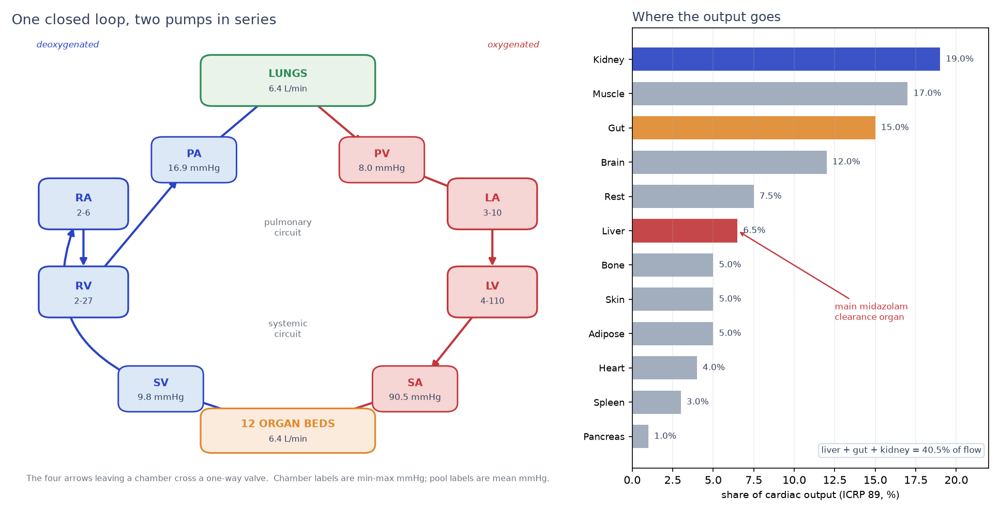
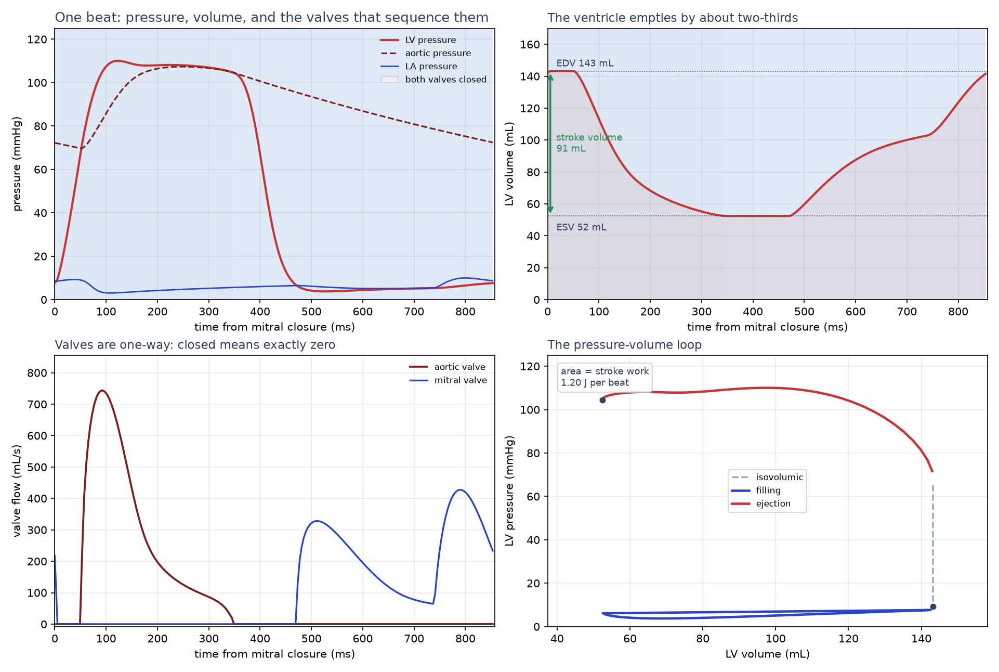
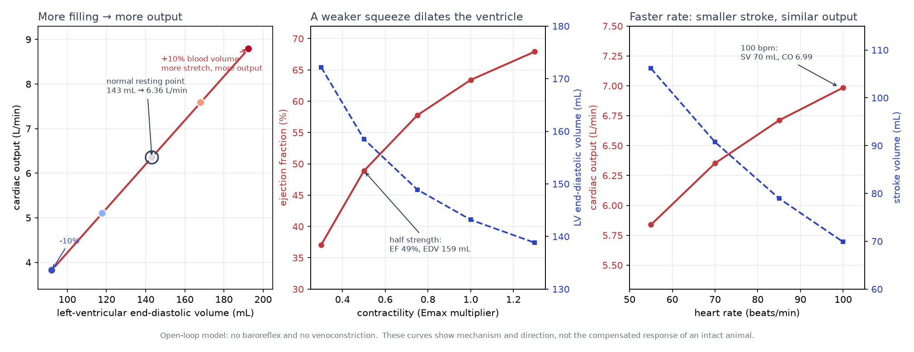
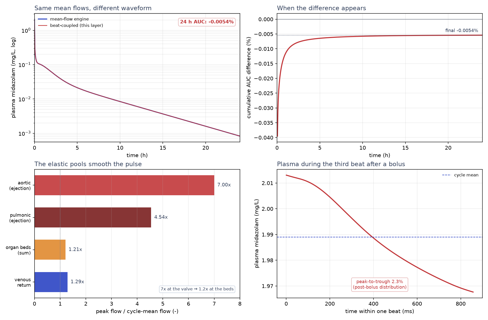
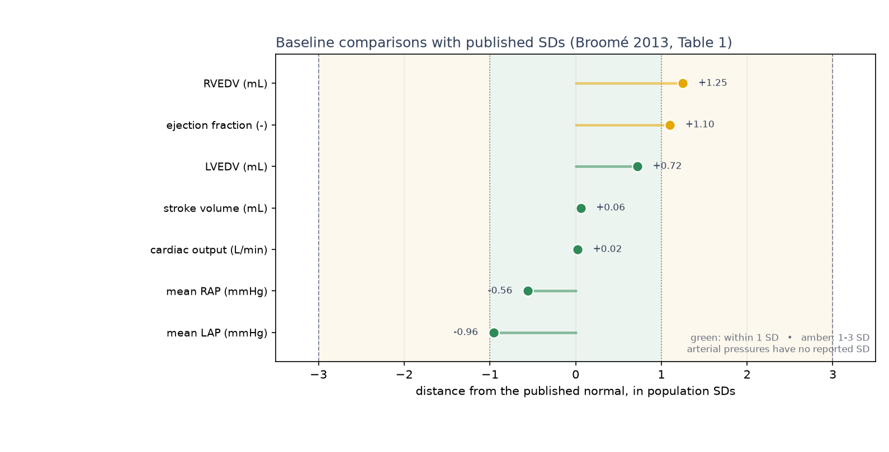
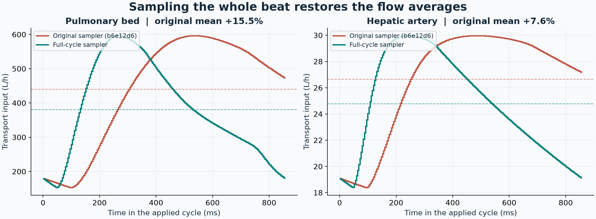
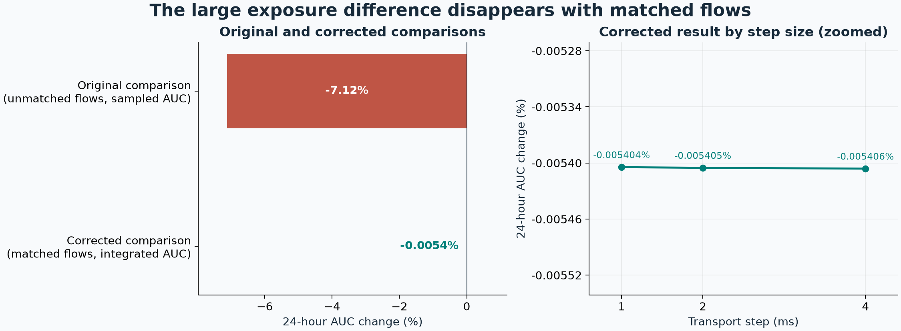
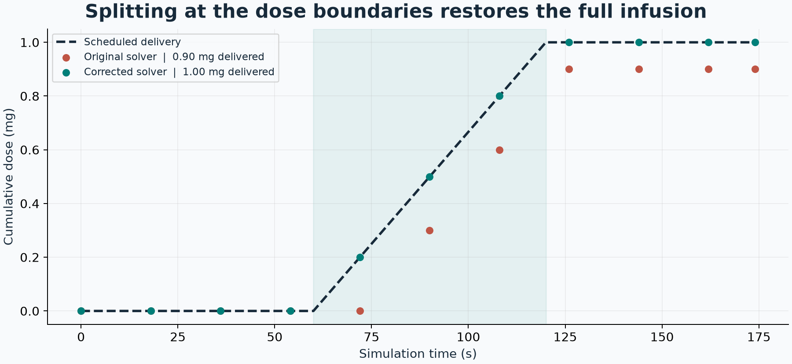

# The beating heart and the drug on its flow, explained simply

This is the plain-language version of the circulation work. It assumes you are
comfortable with basic physics and biology (pressure, flow, a heart pumps blood)
but not with physiology or pharmacokinetics. The precise model is in
[`circulation.md`](circulation.md); the measured numbers and their independent
referees are in [`validation_circulation.md`](validation_circulation.md).

## The one-paragraph version

A heart is **two pumps in series on one closed loop**. We built that loop from
four chambers whose stiffness changes during a beat, four one-way valves, four
elastic pools, and the body's twelve organ beds. Filled with 5.3 L of blood and
beating at 70/min, it predicts a normal resting circulation: **6.35 L/min,
107/70 mmHg, 63 % ejection fraction** — none of it fitted to those answers. Then
we took the drug model the project had already validated against clinical data
and let it ride the flows this heart makes. With the full pulse and the same
average flow in both solvers, 24-hour midazolam exposure changes by about
**−0.0054%** in the reference simulation.

## 1. A circulation is a loop, not a tree

A tree of pipes can tell you what is connected. It cannot tell you which way the
blood goes. Blood goes **down a pressure gradient**, and the heart is what keeps
resetting the pressure.

<p align="center">
  
</p>

Follow one drop around the loop: the left ventricle ejects it at about
110 mmHg into the aorta, the arteries sit near 90, the organ beds drop it to the
venous pool at about 10, and the vena cava delivers it to the right atrium at
about 3.5 mmHg. The right heart then pushes it through the lungs at ~17 mmHg and
back to the left atrium at ~6. **Each pump adds pressure; the vessels spend it.**
That is why the left heart is thick and high-pressure and the right heart is
thin and low-pressure: they drive the same flow through two very different
resistances.

Each organ bed is a resistance $R$, and the flow through it is

$$
q = \frac{p_{\text{artery}} - p_{\text{vein}}}{R}.
$$

All twelve beds see the same pressure difference, so they split the output in
proportion to $1/R$ — which is exactly the ICRP 89 flow split. The kidney
gets 19 %, muscle 17 %, gut 15 %, brain 12 %, and the liver 6.5 %. The liver is
small in flow but is the main midazolam clearance organ, and it also receives
the gut's venous blood first (first-pass). That is the bridge to the drug
layer: **the same flows that feed the organs decide where the drug goes.**

## 2. One heartbeat, in four phases

The muscle does not have a fixed stiffness. It contracts and relaxes, so we
describe each chamber by a **time-varying elastance**:

$$
p(t) = E(t)\,\bigl(V(t) - V_0\bigr).
$$

When $E$ is high the chamber is stiff — a small volume change makes a big
pressure. When $E$ is low it is floppy — it fills at low pressure. The four
valves are passive one-way doors: they open when the upstream pressure exceeds
the downstream pressure, and they allow exactly zero reverse flow.

<p align="center">
  
</p>

The beat therefore has four phases:

1. **Filling.** The mitral valve is open, the ventricle relaxes, and blood
   pours in. Volume rises to the end-diastolic volume (143 mL here).
2. **Isovolumic contraction.** The mitral valve has closed and the aortic valve
   has not opened yet. The muscle squeezes, but the volume cannot change, so the
   pressure shoots up. (That is what "isovolumic" means: same volume.)
3. **Ejection.** The aortic valve opens and volume falls from 143 to 52 mL
   while the pressure stays high. The difference — **91 mL** — is the stroke
   volume. The fraction of the filled volume that leaves is the **ejection
   fraction**, 63 %.
4. **Isovolumic relaxation.** The aortic valve closes, the muscle lets go, and
   the pressure falls at constant volume until the mitral valve opens again.

The bottom-right panel is the same beat drawn as pressure against volume. Its
width is the stroke volume, its height is the pressure, and its **area is the
work done in one beat — about 1.2 J**. A failing ventricle typically shifts
this loop right (bigger, fuller) and narrows it (less ejection); a stronger one
shifts it left and widens it.

## 3. Why the heart pumps what it does

Three knobs explain most of the normal behaviour. The model gets all three
directions right without being told them.

<p align="center">
  
</p>

- **Fill it more, it pumps more.** Adding 10 % blood volume raises the
  end-diastolic volume to 193 mL and the output to 8.79 L/min. This is the
  Frank–Starling law: stretch the muscle, and it contracts harder. In the
  normal range the model's output is almost proportional to filling.
- **Squeeze harder, it ejects more.** Raising contractility (Emax) by 30 %
  raises ejection fraction to 68 % and output to 6.60 L/min. Halving it drops
  ejection fraction to 49 %, dilates the ventricle to 159 mL, and raises left
  atrial pressure — the direction of systolic heart failure.
- **Beat faster, stroke less, output slightly more.** At 100/min the stroke
  volume falls from 91 to 70 mL because there is less time to fill, but the
  output rises to 6.99 L/min because there are more beats.

These sweeps are **open-loop**: the model has no baroreflex and no
venoconstriction. A real animal facing a 20 % hemorrhage would constrict veins
and speed up the heart to defend pressure. This model does not, so at −20 % it
collapses to 1.2 L/min and 17 mmHg — more extreme than life. The sweeps are
there to show the mechanism and its direction, not to predict the compensated
response.

## 4. Putting a drug on the beat

The project already had a whole-body **PBPK** model — physiologically based
pharmacokinetics: 13 organs plus blood, each with a volume, a blood flow, and a
tissue–blood partition coefficient; liver metabolism from in-vitro clearance;
kidney filtration; and an oral absorption chain. It had been scored against
82 clinical midazolam datasets (28 IV and 54 oral).

We did **not** write a second pharmacokinetic model. We kept that model's state,
volumes, partitioning, clearance and absorption, and replaced only its flows
with the beat's own $q(t)$. Three things make this a controlled swap:

- At the ICRP reference flows, the new transport matrix is **identical** to the
  validated engine's (largest difference: 0.0).
- On a flat flow template, the beat solver reproduces the steady solver.
- The beat-coupled run conserves total drug, including drug already eliminated.
  Whole beats can be advanced together using a matrix power.

<p align="center">
  
</p>

Does pulsing the flow matter if the average stays the same? The steady solver
uses the exact average of each organ's sampled flow over a full beat. Both
solvers accumulate AUC, the area under the plasma concentration curve, during
transport. For 5 mg IV plus 7.5 mg oral midazolam, the difference over 24 hours
is about **−0.0054%**. The earlier −7.1% comparison stretched half a heartbeat
across the full period and raised mean flow. The corrected result is stable at
4, 2 and 1 ms transport steps and is a prediction of this model.

The elastic pools smooth the ejection pulse before it reaches the organ beds.
The lower right panel shows plasma during the third beat after a bolus, while
the drug is distributing. Its peak-to-trough change includes that transient.

On the Olkkola 1993 control arms, the pulsatile AUC prediction/observation
ratios are **1.26 (IV)** and **1.15 (oral)**. The ICRP mean-flow engine gives
1.25 and 1.15. This clinical comparison includes differences in average flow.

## 5. Why believe the baseline

The baseline is a prediction, not a fit. Every input — valve areas, chamber
stiffnesses, compliances, the blood-volume split, the organ flow shares — comes
from a published source. The **outputs** are then compared with the published
normal column of Broomé et al. 2013, Table 1, which is a different model's
normal values.

<p align="center">
  
</p>

Where the table gives an SD, the model is within one SD except for ejection
fraction and right-ventricular end-diastolic volume, which are within two. The
arterial pressure references have no SD in that table. The simulation also
checks conservation and agreement with the existing drug transport matrix.

| Identity | Measured |
|---|---|
| Total blood volume is conserved over 8 beats | **1.6×10⁻¹¹ mL drift** |
| The two ventricles eject the same stroke volume | 6.5×10⁻⁵ relative |
| Closed valves carry exactly zero flow | **0** mL/s |
| Every organ's share of flow equals its ICRP share at every instant | **2.2×10⁻¹⁶** relative |
| At ICRP flows, the drug matrix equals the validated PBPK matrix | **0.0** |
| 24 h of beat-coupled drug transport conserves mass | **about 10⁻¹⁰ mg** |

The last two matter because they separate "new physiology" from "new plumbing".
The circulation is new; the pharmacokinetics is the engine that was already
validated, wearing the heart's flows.

## What this does **not** do

- **No reflexes.** No baroreflex, chemoreflex, venoconstriction, pericardial or
  intrathoracic pressure. It is a normal resting circulation.
- **Drug volumes are held constant.** Only the flows are pulsed; the blood-pool
  *volumes* still follow the PBPK engine's constant values. Volume waves are the
  documented next coupling step. This is deliberate: it isolates the
  flow-waveform effect.
- **Oral absorption is not flow-coupled.** The validated stomach/intestine
  chain is used as-is; villous blood flow is not pulsed.
- **Ideal valves and blood.** Bernoulli orifices, no leaflets or regurgitation;
  Newtonian blood; lumped compliances, no distributed pressure waves.
- **Every organ bed shares one pressure gradient.** Their instantaneous flows
  are therefore exactly proportional. Real vascular beds have different
  compliances and impedances, so their pulse waveforms differ by organ. The
  *mean* split is the validated ICRP one; the pulse *shape* per organ is a
  simplification.
- **The waveform comparison checks numerical convergence and matched means.**
  The magnitude remains a model prediction.
- **Hepatic extraction is slightly low.** The bottom-up in-vitro clearance gives
  an extraction ratio of 0.284, just below the published 0.30–0.50 band; the
  one-factor middle-out calibration gives 0.309. Both are reported.

## What changed when we fixed the solver

The original solver used the first half of the pulse over the entire cycle. The
charts below use the actual inputs from both implementations. Dashed lines in
the first chart show each cycle average.



The next chart compares the originally reported exposure change with the
corrected experiment. Its right panel magnifies the differences across three
transport step sizes.



The infusion chart shows a 1 mg dose scheduled from 60 to 120 seconds. Dots
are measured at the same observation times. The original implementation
delivers 0.90 mg and the corrected solver delivers 1.00 mg.



Regenerate these three figures with `python scripts/plot_circulation_verification.py
--before /path/to/original-checkout`. The original checkout for these figures
is `b6e12d6`. Run `scripts/validate_circulation.py` first to refresh the
step-size results for the corrected solver.

## Try it

```bash
python scripts/validate_circulation.py        # the full report + validation figures
python scripts/plot_circulation_explainer.py  # the five charts on this page
pytest -q tests/test_circulation.py
```

The core API:

```python
from vh.body import MIDAZOLAM, PBPKModel, Dose, reference_individual
from vh.graph.circulation import CirculationParams, HeartCirculation
from vh.graph.uptake import CirculationUptakeModel

ind = reference_individual("male")
heart = HeartCirculation(CirculationParams.from_individual(ind))
beat = heart.simulate(n_beats=45, dt=1e-3, record_last=8)

print(heart.beat_summary(beat)["cardiac_output_l_min"], "L/min")

drug = CirculationUptakeModel(PBPKModel(MIDAZOLAM, ind), heart)
profile = drug.simulate_pulsatile(
    beat, [Dose(0.0, 5.0, "iv"), Dose(0.0, 7.5, "oral")], 24.0)
```

If you want the equations and parameters, read [`circulation.md`](circulation.md).
If you want the measured validation, read
[`validation_circulation.md`](validation_circulation.md). For the flow-graph
machinery underneath, read [`bernoulli_veins.md`](bernoulli_veins.md) and its
plain-language companion [`flow_explained.md`](flow_explained.md).
