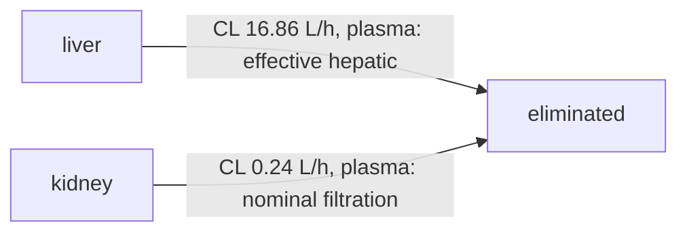
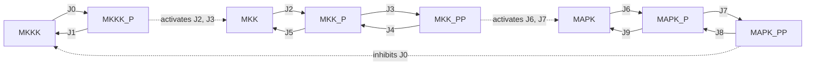

# Formalizing the body as a graph — and what that lets code solve

> Short answer to "if we formalize the body into a graph, can we solve problems
> with code?": **yes, for a specific and useful class of problems** — the
> structural and relational ones — and the graph also becomes the scaffold that
> wires the physics engines together and lets any part be verified on its own.
> It does **not** turn the body's quantitative, continuous core (binding,
> kinetics, folding) into something solvable by symbol-pushing; that stays
> physics. The power is the combination.

## The idea

The body is already a graph at every scale:

- **organism / organ**: compartments (organs, blood pools) joined by **blood flow**;
- **molecule**: species joined by **reactions / transport / binding**;
- **atom**: atoms joined by **bonds**.

`vh.graph` is one typed property graph for all of them. Nodes and edges carry a
`type`, a `scale`, free-form attributes, and — where it matters — the name of the
**validated computational model** behind an edge (a PBPK blood flow, a
Rodgers–Rowland partition coefficient, a quantum binding constant). So the graph
is a *map* of the system that is also partially *executable* and, crucially,
*verifiable in pieces*.

A `Schema` states what a valid formalization is: which node/edge types are legal,
what attributes they must carry, and **structural invariants** — e.g. "blood flow
is conserved at every compartment." Invariants are checked by graph algorithms,
not taken on trust.

## What graph algorithms actually answer (exactly)

Built from scratch in `vh.graph.algorithms` and demonstrated in
`scripts/validate_graph.py` on the real, validated midazolam PBPK model:

| Question | Algorithm | Result on the real model |
|---|---|---|
| Is the formalization physically consistent? | flow balance (Kirchhoff) | blood conserved at every compartment to **1.5×10⁻¹⁶** (relative) |
| Where can a drug reach? | reachability (BFS/DFS) | IV drug reaches all 14 compartments incl. brain |
| What route does an oral drug take first? | path enumeration | `gut lumen → gut → liver` — **first-pass metabolism falls out of the topology** |
| Does anything recirculate? | strongly-connected components | one loop spanning 15 compartments — the systemic circulation |
| Where are the hubs / bottlenecks? | betweenness centrality | arterial, venous, lung (all of cardiac output passes through) |
| Which reported clearance parameter is larger? | edge analysis | liver 99% vs kidney 1% of the plasma-referenced reporting sum; see the distinction below |

These are not approximations — they are the exact answers the graph structure
determines.

## From topology to quantitative flow: constitutive laws on edges

Topology alone cannot tell you the pressure in a vein. To predict *how much*
flows, attach a constitutive law to every edge and a storage law to every node.
That is what [`vh/graph/flow.py`](../vh/graph/flow.py) does. The graph becomes a
lumped, 1-D Navier–Stokes solver:

$$
C_i\dot p_i=\sum_e B_{ie}q_e+s_i,\qquad
L_e\dot q_e=p_{\text{src}}-p_{\text{dst}}-h_e-R_eq_e-\Delta p_{\text{kinetic}}-\Delta p_{\text{minor}},
$$

with $R=8\mu\ell/(\pi r^4)$, $L=\rho\ell/A$, $h=\rho g\Delta z$, a Bernoulli
kinetic term, and optional Starling collapse and one-way valves. The edge
equation is exactly the integrated momentum balance; rearranged, it is extended
Bernoulli:

$$
p_1+\tfrac12\rho v_1^2+\rho g z_1
=
p_2+\tfrac12\rho v_2^2+\rho g z_2
+L\dot q+Rq+\Delta p_{\text{minor}}.
$$

This is validated against exact solutions, not against itself:

| Check | Independent authority | Measured error |
|---|---|---|
| Poiseuille flow | $q=\Delta p/R$ | $1.6\times10^{-16}$ relative |
| Windkessel transient | $qR(1-e^{-t/RC})$ | 0 Pa (matrix exponential) |
| Starling waterfall | analytic waterfall law | $2.2\times10^{-19}$ m³/s |
| Lumped R–L vs pulsatile flow | exact Womersley $Z(\omega)$ | <1% for $\alpha\le0.48$; 20.7% at $\alpha=5$ |
| Standing venous pressure | physiology 85–90 mmHg | foot **88.7 mmHg** (inside range) |

The same graph predicts the lower-limb venous pressure profile from anatomical
geometry, without fitting the pressure reference:


The honest boundary moves, but does not disappear. A graph with a *validated
constitutive law* on each edge can answer "how much flows" in the regime where
that law holds. It cannot answer arbitrary continuum physics: the lumped R–L edge
is a low-Womersley-number model, wave propagation needs a 1-D PDE rung, and local
3-D wall shear needs CFD. The derivation, the failure modes, and the method
ladder are in [`bernoulli_veins.md`](bernoulli_veins.md) and
[`prediction_methods.md`](prediction_methods.md); the measured report is
[`validation_flow.md`](validation_flow.md) and
[`validation_flow.json`](validation_flow.json).

## Clearance reporting and independent verification

Because the formalization is compositional, any subgraph can be pulled out and
checked on its own:

- **render** any subgraph to a diagram (`vh.graph.render`, via Mermaid) and
  inspect the [whole-body source](img/pbpk_graph.mmd) or
  [elimination subgraph source](img/pbpk_elimination_subgraph.mmd);
- **check the export**: elimination edges carry explicit `units="L/h"` and
  `reference_basis="plasma"`. Since `C_blood = bp * C_plasma`, conserving
  elimination rate requires `CL_plasma = bp * CL_blood`. The schema rejects
  missing/mixed reference bases, incorrect units, and nonfinite or negative
  clearances. The exported sum is **17.104405 L/h** for reference male midazolam,
  matching the body's *reported parameter sum*. This replaces a previous
  **28.488253 L/h** sum that mixed hepatic blood and renal plasma references.
- **verify independently**: the script integrates the linear ODE analytically,
  `integral(x dt) = -M_active^-1 x(0)`, for a 1 mg IV bolus. Dose divided by
  venous plasma AUC is **17.103070 L/h**, agreeing with the exact well-stirred
  organ mass balance to less than **1e-10 L/h**. Tests separately check exported
  hepatic rates against exact rational mass balance at blood:plasma ratios of
  0.5, 1 and 2, so a ratio of 1 cannot hide the reference error.

These checks answer different questions. Renal `cl` is a **nominal filtration
parameter** (`fu * GFR`), whereas hepatic `cl` is a **well-stirred effective
clearance**. Each edge records its `clearance_kind` and source. The finite renal
blood flow makes exact systemic clearance slightly smaller than the reporting
sum: **0.001336 L/h** in this example. With `q = renal blood flow * bp`, the
effective renal clearance is `q * cl_renal / (q + cl_renal)`. The shared plasma
basis makes export aggregation well defined, but does not make these parameters
identical to the ODE's local tissue elimination coefficients or independently
validate the biology. This change leaves the PBPK ODE and its inputs unchanged.



The full diagrams remain reproducible from the linked Mermaid sources. Old
raster/vector images with mixed reference values have been removed.

## Reaction networks from SBML

`vh.graph.sbml` reads a declared subset of SBML (Levels 2 and 3 core) from
scratch: compartments, species, parameters, function definitions, initial
assignments, assignment rules and reactions with MathML kinetic laws. Anything
outside the subset — events, rate or algebraic rules, delays, fast reactions,
stoichiometryMath, conversion factors, required packages — is refused by name,
never silently dropped. A model becomes

- an **executable network**: reaction rates, `d amount / dt = N v`,
  trajectories, steady states and the Jacobian restricted to the stoichiometric
  class; and
- a **typed graph**: `species`, `reaction`, `compartment` and `moiety` nodes;
  `reactant`/`product` edges carrying exact stoichiometry, `modifier` edges, and
  `member` edges from each species to the conserved moieties it belongs to.

The graph schema adds four invariants, each recomputed from the graph's own
edges rather than trusted from the importer:

- **stoichiometry** — every coefficient is a positive exact rational;
- **located** — every species is in exactly one compartment;
- **conservation** — each moiety is an exact left-null vector of `N`
  (`l . N = 0` in rational arithmetic), the moieties are independent and span
  the whole left nullspace, and each total equals the weighted initial amounts;
- **stoichiometric consistency** — every reacting species admits a strictly
  positive mass conserved by all internal reactions (Gevorgyan et al. 2008).
  Each answer carries an exact certificate: a mass vector, or a reaction
  combination that provably creates the unconserved species from nothing.

Validated on three CC0 BioModels in [`data/sbml/`](../data/sbml/sources.json)
against exact algebra and libRoadRunner as an independent referee (details in
the [auto-research report](../auto-research/2026-11-05-E-sbml-import/report.md)):

| Model | Exact conservation laws | Referee agreement |
|---|---|---|
| Kholodenko 2000 MAPK oscillator (BIOMD0000000010) | 3 kinase totals (100, 300, 300) | trajectories 7e-10; unstable fixed point and eigenvalues match; period 1299.77 to 9e-12 |
| Huang & Ferrell 1996 MAPK cascade (BIOMD0000000009) | 7 enzyme/kinase/phosphatase totals | trajectories 6e-10; stable steady state 2e-12; eigenvalues 8e-10 |
| Elowitz & Leibler 2000 repressilator (BIOMD0000000012) | none (open system) | trajectories 7e-10; unstable fixed point; period 125.354 to 2e-12 |



The full imported graph, including reaction nodes and moieties, is in
[`img/kholodenko_mapk_sbml.mmd`](img/kholodenko_mapk_sbml.mmd).

## Rate-dependent invariants: integrals become checks

Stoichiometric conservation laws depend only on the reaction structure. Some
useful identities also depend on rate values. Grouping mass-action reactions by
their reactant monomial gives an exact linear system whose nullspace is every
weight vector conserved along every trajectory; `ReactionNetwork.kinetic_invariant_basis()`
returns it in exact rationals. Adding an accumulator (`A -> A + U`) turns a
path integral into a state, so identities such as *amount eliminated = k × AUC*
or a cumulative-hazard/exposure balance become invariants the finder discovers
on its own. In the [paraneoplastic exposure experiment](../auto-research/2026-11-05-E-paraneoplastic-exposure/report.md)
it recovered Project Asma's exposure identity, then caught a wiring error: a
hypothesis meant to be release-only still had burden presentation switched on,
and the pure identity correctly failed. Details and limits are in
[reaction experiments](reaction_experiments.md#kinetic-invariants-and-cumulative-exposure).

## The graph verifying the physics engine

The sharpest demonstration that the formalization is faithful: a **pure graph
algorithm reproduces part of the force field**. In molecular mechanics, the
atoms that must be excluded or down-weighted in the nonbonded sum are exactly the
1-2, 1-3 and 1-4 neighbors — i.e. atom pairs within **graph distance ≤ 3 on the
bond graph**. Running breadth-first search on the bond graph of Trp-cage and
chignolin recovers the engine's exclusion list **exactly** (1687 pairs for
Trp-cage, symmetric difference 0). A topological fact, computed by a graph
algorithm, matches the physics engine's own bookkeeping — each checks the other.

Rings (aromatic side chains, proline) show up as the cycles of the same graph;
molecules show up as its connected components.

## So, can we "solve the body with code"?

**What a graph solves, exactly:**
- structure and reachability — what connects to what, what can affect what;
- pathways and flows — routes, first-pass effects, dominant fluxes, bottlenecks;
- conservation and consistency — mass/flow balance, no orphan compartments,
  schema conformance — as checkable invariants;
- recirculation and feedback — cycles and strongly-connected components;
- composition and partial verification — check a part without the whole.

**What a graph does not solve by itself:**
- *how much / how fast / how strong* — binding free energies, reaction rates,
  folding. Those are continuous physics, answered by `vh.quantum`,
  `vh.molecular`, `vh.body`, not by topology. A graph that *claimed* to settle
  them by structure alone would be lying. The exception is when the edge carries
  a validated constitutive law: then the graph is a solver, and the law — not
  the topology — answers *how much*. `vh.graph.flow` does exactly that for 1-D
  flow, with the regime of validity stated and measured.

**Why the combination is the real answer.** The graph is where the scales meet:
an edge labeled `binds` carries a `Kd` that a quantum free-energy calculation
produces; an edge labeled `flow` carries a number the PBPK model validated
against clinical data; an edge labeled `clears` carries an IVIVE clearance. The
graph routes information between these models, lets each be swapped or refined
independently, checks that the whole stays consistent, and lets you verify any
piece on its own. That is a real, buildable path to "solving problems with code"
about the body — not by replacing the physics with a graph, but by giving the
physics a formal, inspectable, verifiable skeleton to hang on.

## Try it

```bash
python scripts/validate_graph.py     # runs every algorithm above, renders the diagrams
python scripts/validate_flow.py      # flow graph vs exact Poiseuille/Windkessel/Starling/Womersley + venous pressure
python scripts/validate_sbml.py      # SBML import against exact algebra and libRoadRunner
pytest -q tests/test_graph.py tests/test_graph_clearance.py tests/test_sbml.py
pytest -q tests/test_flow.py         # 24 tests incl. the exact flow authorities
```
